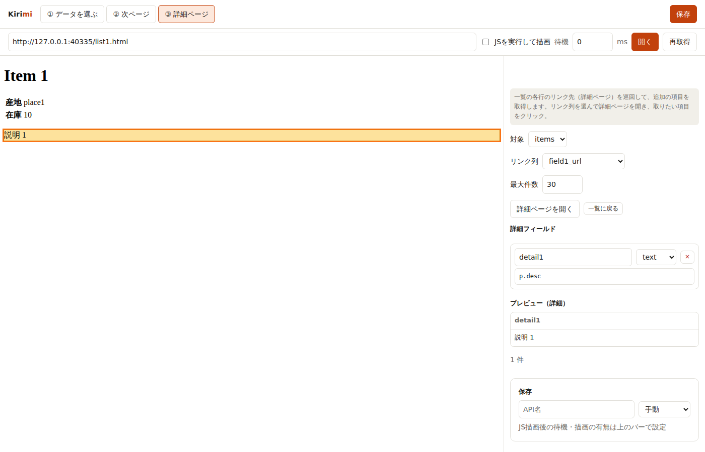
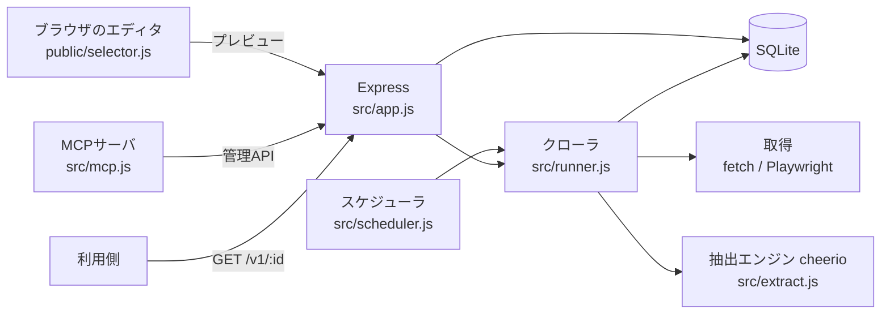

# Kirimi（切り身）

Webページの欲しい部分をクリックするだけで、定期取得される JSON / CSV / RSS の API にできるセルフホスト型スクレイパー。2016年に終了した Kimono Labs の体験を再現したもの。



## 概要

RSS のないサイトの新着や、表形式で並んだ情報を「データとして」使いたいとき、サイトごとにスクレイピングのコードを書くのは手間がかかります。Kirimi はページを開いて取りたい項目をクリックすると、似た要素と「行」を自動で推定してセレクタを作り、その結果を定期実行して API として公開します。Claude Code から MCP 経由で操作することもでき、「このページの新着を毎日取る API を作って」と頼めます。

エディタのプレビューも定期実行も同じ抽出エンジン（`src/extract.js`）を通すため、画面で見えた結果と実際に取れるデータが一致します。

## 主な機能

- **クリック選択**: 項目を1つクリックすると似た要素と行を推定。同じ行の別項目をクリックすると列が増え、もう一度クリックで外れる。Alt+クリックで親要素を選択
- **一般化**: 1件しか拾えなかったとき、同種の2つ目をクリックすると共通セレクタにまとめる
- **リンク**: リンク内をクリックすると、テキスト列と `*_url`（href）列を同時に作る
- **複数コレクション**: 1ページから複数の表を取得
- **ページ送り**: 「次へ」リンクを指定。最大ページ数を設定でき、同じ URL は2度読まない
- **詳細ページ巡回**: 一覧のリンク列をたどり、詳細ページの項目を追加
- **JS 描画**: Playwright（Chromium）で描画してから取得するか、通常の HTTP 取得かを選択
- **定期実行**: 手動 / 15分 / 1時間 / 毎日 / 毎週。実行履歴は API ごとに既定50件保持
- **公開 API**: `GET /v1/:id?token=…&format=json|csv|rss&collection=…&run=…`（`Authorization: Bearer` も可。CSV は Excel 用に BOM 付き）
- **MCP サーバ**: `src/mcp.js`（stdio）。ページ取得・プレビュー・API の作成/変更/削除・実行・データ取得を Claude Code から呼べる

## 技術スタック

Node.js 20 以上（ES Modules、ビルド工程なし）/ Express 5 / better-sqlite3 / cheerio / Playwright / @modelcontextprotocol/sdk / zod / フロントは素の HTML・CSS・JS / テストは Node 組み込みの `node --test`

## アーキテクチャ



ブラウザ側の `selector.js` が作るセレクタは、cheerio でも同じ意味になる構文（タグ・クラス・`:nth-of-type`・`>`）に限定しています。

## セットアップと起動

```bash
npm install
npx playwright install chromium   # JS描画を使う場合（初回のみ）
ADMIN_PASSWORD=<your-password> npm start   # 既定 http://0.0.0.0:8790
```

| スクリプト | 内容 |
|---|---|
| `npm start` | サーバ起動 |
| `npm run dev` | `node --watch` で起動 |
| `npm test` | テスト実行 |
| `npm run mcp` | MCP サーバ（stdio）を起動 |

| 環境変数 | 既定値 | 説明 |
|---|---|---|
| `ADMIN_PASSWORD` | なし | 管理画面のパスワード。未設定だと認証なし（信頼できるネットワーク内限定） |
| `SESSION_SECRET` | `ADMIN_PASSWORD` | ログイン Cookie の署名鍵 |
| `PORT` / `HOST` | 8790 / 0.0.0.0 | 待ち受け |
| `KIRIMI_DB` | `data/kirimi.db` | SQLite のパス |
| `KIRIMI_KEEP_RUNS` | 50 | API ごとに残す実行履歴の数 |
| `KIRIMI_UA` | Chrome 風 + Kirimi | User-Agent |

Claude Code への MCP 登録（`KIRIMI_URL` の既定は `http://127.0.0.1:8790`、パスワードは `KIRIMI_PASSWORD`）:

```bash
claude mcp add --scope user kirimi -- node /path/to/Kirimi/src/mcp.js
```

使い方: 「＋ 新しいAPI」→ URL を入れて開く → 項目をクリック → 列名を調整（任意で次ページ・詳細ページ）→ 保存 → 「今すぐ実行」→ 表示されたエンドポイントから取得。`deploy/kirimi.service` は systemd 常駐用のユニット例（パスは自分の環境に合わせて書き換え）。

## ディレクトリ構成

```
src/
  extract.js     抽出エンジン（プレビューと本番で共通）
  fetcher.js     取得（fetch / Playwright）とエディタ用キャッシュ
  runner.js      1回のクロール（ページ送り・詳細巡回）と設定チェック
  scheduler.js   定期実行と二重実行防止
  app.js         管理API・公開API・認証
  db.js          SQLite
  mcp.js         MCPサーバ
  server.js      エントリポイント
public/          エディタ・詳細画面（selector.js がクリックからセレクタを生成）
test/            テストと模擬サイト（fixtures）
deploy/          systemd ユニット例
```

## Claude Code での開発

- `CLAUDE.md` に設計上の不変条件を明文化（抽出は必ず `extract.js` を通す、ブラウザ側セレクタは cheerio 互換の構文に限る、行相対セレクタの意味 など）し、Claude Code が変更のたびに守れるようにしている
- テストは `test/` に5ファイル（セレクタ生成、管理/公開API・認証、ページ送り・詳細巡回のクロール、MCP、エディタの通し操作 E2E）。ローカルの模擬サイトを相手にするため外部サイトに依存しない
- 変更後は `npm test` を通してから反映する運用
- 自作した MCP サーバを Claude Code に登録し、Claude Code 自身が Kirimi の API を作成・実行して使う（作ったツールを AI から使う循環）

## ライセンス

未定

## 注意

- 管理者は任意の URL をサーバから取得できます。公開環境では必ず `ADMIN_PASSWORD` を設定し、VPN やアクセス制御の内側に置いてください
- 取得先サイトの利用規約と robots.txt を守ってください。ページ間の待機（既定1秒）は短くしすぎないでください
- エディタはページのスクリプトを除いて表示するため、JS で描画するサイトでは「JSを実行して描画」をオンにします
